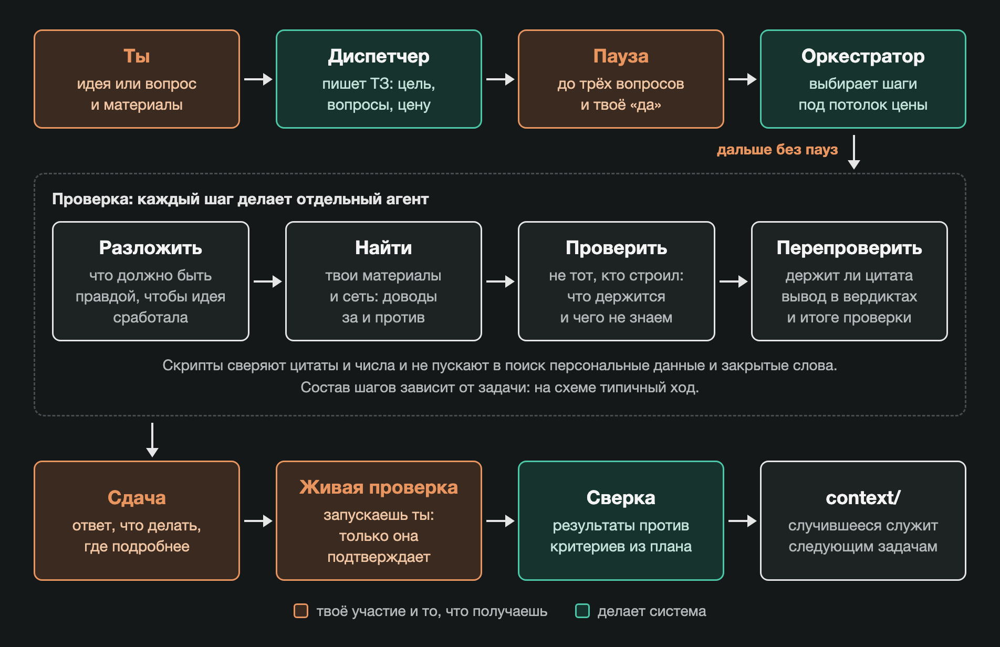

# Полигон гипотез

Система агентов для продуктовых и маркетинговых гипотез. Ты приносишь идею или вопрос, она проверяет это по твоим материалам и по сети и возвращает ответ: что держится, что нет, что делать дальше и как проверить на живых людях.

Например, ты приносишь текст о целевой аудитории и просишь его провалидировать. Система раскладывает его на утверждения, которые должны быть правдой, чтобы идея сработала, и проверяет каждое. В ответе видно, что убрать, что усилить и что оставить. Там, где без внутренних данных не обойтись, она предлагает несколько объяснений и проверку, которая покажет, какое из них верно.

Проверка по материалам и сети гипотезу не подтверждает. Она отсеивает слабое и готовит живую проверку. Подтвердить может только то, что случилось на самом деле.

## Как начать

1. Открой Claude Code в корне проекта, где лежит `AGENTS.md`. Хуки, скиллы и агенты подгружаются при старте сессии.
2. Положи в `context/` всё, что знаешь о продукте и клиентах. Что подойдёт, написано в `context/README.md`. Пусто тоже можно: система пойдёт в открытые источники и скажет, чего не хватило.
3. Напиши `/dispatcher` и свою задачу. Если в среде нет слеш-команд, напиши «диспетчер, …».
4. Диспетчер покажет ТЗ и задаст не больше трёх вопросов. Ответь и согласуй одним сообщением. Проверь, что первым пунктом стоит твой вопрос, и прочитай строки «ЧТО ПОЛУЧИШЬ» и «ЦЕНА».
5. Дальше система работает сама. В приложении Claude маршрут уходит в новую сессию, и диспетчер даёт на неё ссылку. В других средах он предложит продолжить здесь или открыть новую сессию и напишет готовую команду.

После живой проверки заполни заготовку из `tasks/<задача>/results-templates/`, положи её в `tasks/<задача>/results/` и напиши диспетчеру. Если в ответе есть запросы данных, отдай их аналитику, а присланное положи в `context/`.

## Что получишь

Тип результата диспетчер выводит из запроса, тебе выбирать его не нужно.

| Что ты просишь | Что будет на выходе |
| --- | --- |
| Оценить идею или постановку | разбор: что не так и что проверить первым |
| «Провалидируй» свою идею или гипотезы | по каждому утверждению доводы за и против, что убрать, усилить и оставить, как проверить. Новых гипотез вместо твоих система не строит |
| Понять, что делать | гипотезы с вердиктами, на что ставить и бэклог тестов |
| Довести до действий | план проверки и материалы для неё |
| Разобрать результаты живой проверки | вердикты по плану прошлой задачи |
| Разобраться, что известно | исследование: ответ по каждому вопросу и насколько ему верить |
| Понять, куда можно пойти | карта направлений с первым шагом по каждому |
| Подготовить работу команде | задание аналитику, бриф редактору и список решений за тобой |

Главный файл — `08-handoff.md`. Он устроен одинаково для всех типов: сначала ответ на твой вопрос, затем от одного до трёх действий, цена, первый шаг и условие, при котором от действия стоит отказаться. Подробности лежат в полных документах, и сдача говорит, в каком разделе их искать. Источники собраны в `08-sources.md`, ход работы и замечания — в `08-service.md`.

## Как проверяется идея

1. **Материалы.** До твоего согласия диспетчер читает `context/`, а размечают файлы скрипты; других агентов он не запускает. Подробный разбор начинается после «да». Фразы в файлах и на страницах, обращённые к ИИ, скрипт убирает в карантин и не исполняет.
2. **Утверждения.** Бриф команды и твоя позиция проверяются так же, как сама идея. Опорой считаются слова клиентов, данные и случившиеся события. Идея раскладывается на утверждения, и каждое проверяется отдельно.
3. **За и против.** Сначала твои материалы, потом сеть. Проверка ищет и то, что могло бы утверждение опровергнуть. Три пересказа одной статьи считаются одним источником.
4. **След.** Фрагмент, на котором стоит вывод, приводится дословно и со ссылкой, а скрипт сверяет его с текстом источника. У числа есть источник или формула.
5. **Второй взгляд.** Гипотезы строит один агент, проверяет другой. По вердиктам и итоговому документу валидации или исследования ещё один агент в отдельном контексте смотрит, держит ли фрагмент сделанный из него вывод. Исключение — одиночный проход для узких задач, где всё пишет один агент: такая проверка независимой не является.
6. **Неизвестное.** Если данных нет, система так и пишет, но на этом не останавливается: даёт лучшую версию с пометкой «оценка», говорит, какие данные её уточнят, и называет шаг, который ты можешь сделать сам.

Живые проверки и материалы источников возвращаются в `context/` и помогают в следующих задачах. Выводы самой системы опорой там не служат.

## Чем ты управляешь

Выбирать уровень нагрузки не нужно. Оркестратор сам решает, какие шаги нужны под твой вопрос, и объясняет в логе, что было бы без каждого из них.

- **Потолок.** Сколько вызовов агентов можно потратить. Диспетчер показывает оценку и потолок в строке «ЦЕНА». Дойдя до потолка, система останавливается и говорит, что осталось непроверенным.
- **Пожелания.** Новые идеи, разведка того, как задачу решают другие, длинный список вариантов, пробный прогон вопросов на выдуманных респондентах. Пробный прогон находит наводящие и непонятные вопросы, о настоящих клиентах он ничего не говорит.
- **Ёмкость.** Сколько проверок ты запустишь за две недели. Бэклог тестов не растёт дальше этого числа плюс один.
- **Закрытое.** Названия, которые нельзя отправлять в поиск. Персональные данные закрыты всегда.

Полный прогон идёт долго и расходует много токенов. Минут и токенов система заранее не обещает.

## Кто что делает

**Диспетчер** превращает запрос в ТЗ и больше ничего не решает. **Ты** отвечаешь на вопросы и согласуешь ТЗ: это единственная плановая пауза. **Оркестратор** ведёт задачу до результата и выбирает, кого звать на следующий шаг. Остановиться раньше он может, если задача оказалась другой, кончился потолок или нужно твоё решение.

Остальные роли узкие: читают материалы, ищут в сети (интервью, боли рынка, аудитория, альтернативы, размер рынка, путь клиента, прошлые эксперименты, чужие подходы), строят гипотезы, проверяют, планируют проверку и собирают итоговые документы. Их список — в `.claude/skills/orchestrator/registry.md`.

## Почему выводам можно доверять и где нельзя

Всё, что можно проверить скриптом, проверяет скрипт: есть ли цитата в источнике, сходится ли посчитанное число, не попали ли в запрос персональные данные и закрытые слова, всё ли обязательное сделано до сдачи.

Скрипт видит только форму. Следует ли вывод из цитаты, смотрит отдельный агент, а в части задач ещё и выборочный аудит. Эти оценки тоже даёт модель, по умолчанию та же, что у авторов, поэтому слепые пятна у них могут быть общими. Перед дорогим решением открой сам несколько опор из сдачи.

Повторный прогон на тех же материалах может дать другие вердикты. Если решение зависит от одного вердикта, проверь его вживую.

## Где запускать

| Среда | Что происходит |
| --- | --- |
| Claude Code | читает `CLAUDE.md`, а тот ведёт в `AGENTS.md`; скиллы находит сам |
| OpenCode | читает `AGENTS.md`; скиллы находит сам |
| Codex, Cursor и другие | читают `AGENTS.md`; если скиллы не нашлись, открывают их по пути |

Систему писали под Claude. На других моделях результат зависит от того, справится ли модель с длинными инструкциями. Хуки (права агентов, запрет править систему по ходу задачи, проверки перед концом ответа) и описания агентов работают только в Claude Code. В других средах скрипты запускаются, если модель делает это по инструкции. Где нет подагентов, все роли по очереди исполняет один агент, и независимая проверка получается неполной.

Поиск идёт через встроенные WebSearch и WebFetch, ключи и платные сервисы не нужны. Свой поисковый API можно подключить локально, не меняя репозиторий (`methodology/web-protocol.md`, п. 2.1).

Чтобы читать PDF, поставь необязательные пакеты: `pip install -r requirements.txt`. Что уже установлено, покажет `python3 scripts/check_env.py`. Файлы `.docx`, `.xlsx`, `.pptx` и обычный текст читаются без дополнительных шагов.

## Что где лежит

| Путь | Что там |
| --- | --- |
| `AGENTS.md` | инструкции, принципы и правила. Если что-то расходится, верен он |
| `.claude/` | скиллы ролей, описания агентов, настройки хуков |
| `methodology/` | модули методологии, указатель `tools-index.md`, протокол поиска `web-protocol.md` |
| `context/` | твои материалы. В git не попадают |
| `tasks/` | папки задач. В git не попадают |
| `scripts/` | проверки, маршрут и хуки; перечень — `methodology/scripts-reference.md` |
| `evals/` | кейсы с известным ответом: пришла ли система к верному выводу |
| `INFRASTRUCTURE.md` | как устроено внутри: параметры прогона, бюджет, модели, ограничения |

Методология — это короткие модули: клиент и его задача, путь клиента, позиционирование и сообщения, цена и каналы, цели и запуск, эксперименты, запросы данных, чтение чужих отчётов, оценки без данных, акции, жизненный цикл клиента, сегменты. Агент открывает только нужный раздел. Разделы без внешнего источника помечены «синтез, проверять на данных».

## Словарь

- **ТЗ** — короткий документ: что ты хочешь получить, чего не хватает, что будет в результате. После согласования система работает по нему, а менять цель можешь только ты.
- **GAP** — вопросы, без ответа на которые цели не достичь. Первым стоит твой.
- **Опора** — дословный фрагмент интервью, данные или случившееся событие. Утверждение команды опорой не считается.
- **Синтетика** — всё придуманное моделью, включая выдуманных респондентов. Свидетельством не считается.
- **Вызов** — один запуск агента. В вызовах считаются цена и потолок.

## Если правишь систему

- Хуки не дают менять скиллы и скрипты по ходу задачи. Перед правкой создай в корне пустой файл `.polygon-dev`, потом удали.
- После правки в `scripts/` запусти `python3 scripts/selftest.py`.
- В репозиторий попадает только система. Примеры в инструкциях и тестах — выдуманные.
- Включи в своей копии проверку перед отправкой: `git config core.hooksPath scripts/git-hooks`. Закрытые слова впиши в `.publish-stopwords`, а обычные слова, совпавшие с закрытыми, — в `.publish-allow`. Оба файла остаются у тебя.
- У каждого правила есть id. Новому его даёт `python3 scripts/rules.py --assign`; в `methodology/rules.csv` заполни, из чего правило родилось и чем проверяется.
- Размер инструкций держит `python3 scripts/check_size.py`: новое правило вытесняет старое или уезжает в файл, который читается по требованию.
- CI (`.github/workflows/selftest.yml`) на каждый пуш запускает самопроверку и проверки инструкций.
- Схема лежит в `docs/architecture.png`, исходник — в `docs/src/architecture.html`. Как переснять, написано в `docs/README.md`.
