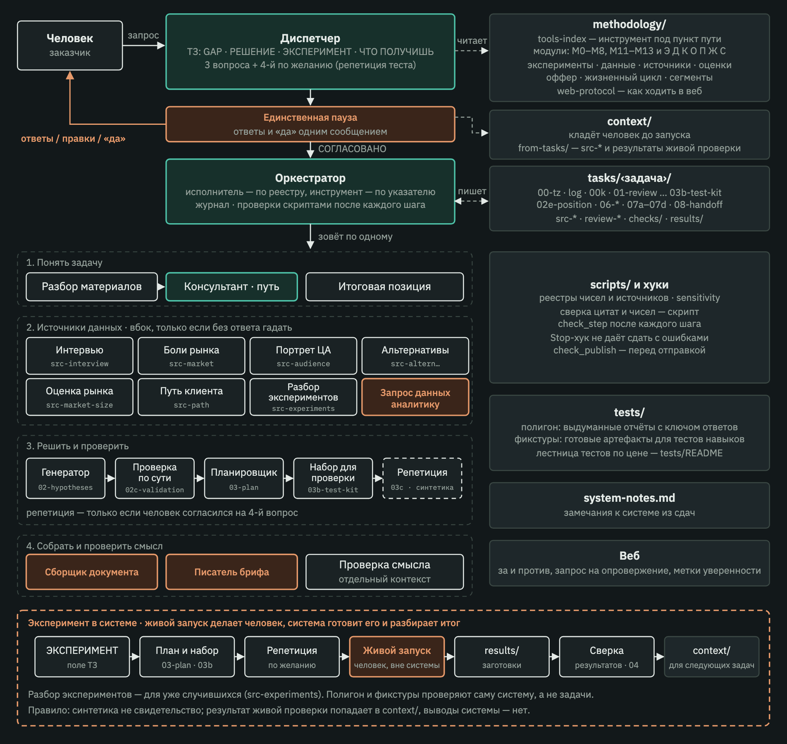
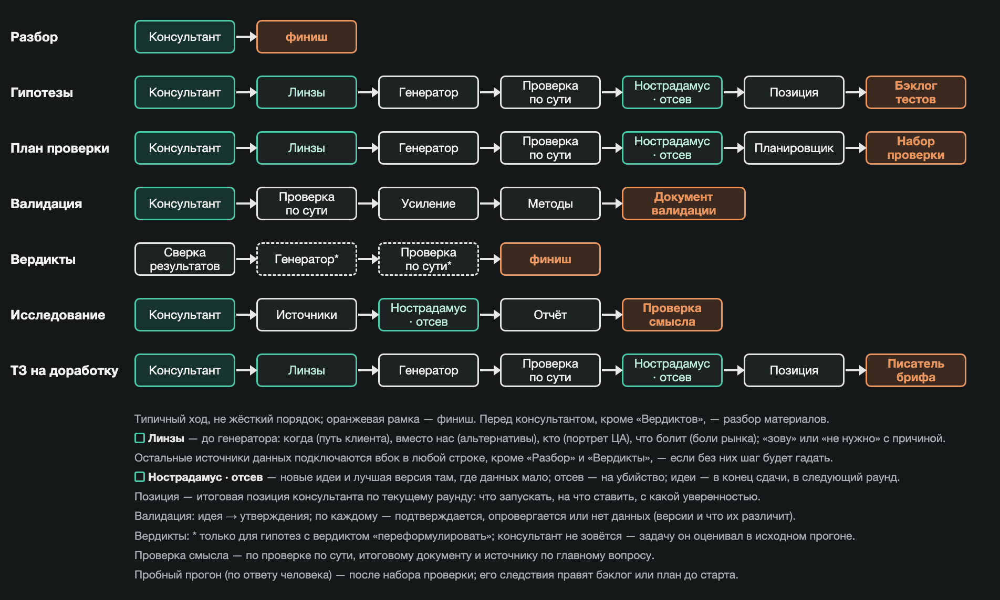
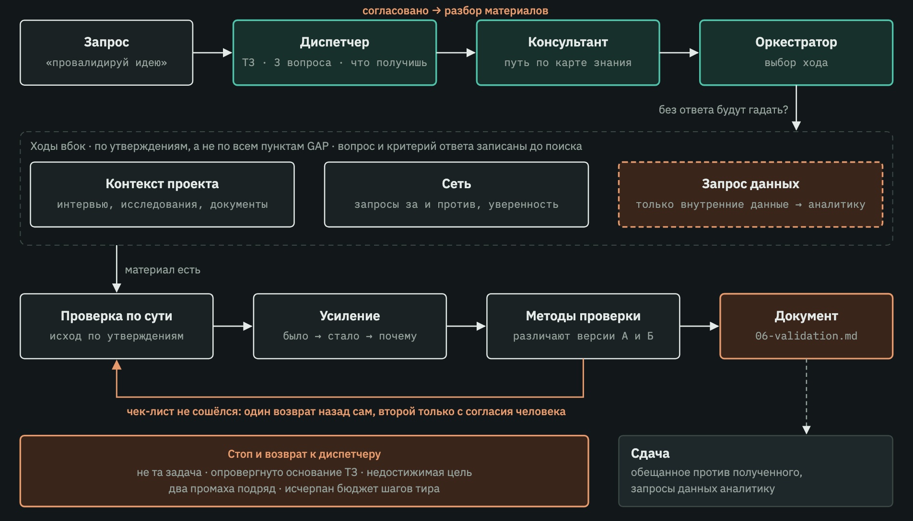
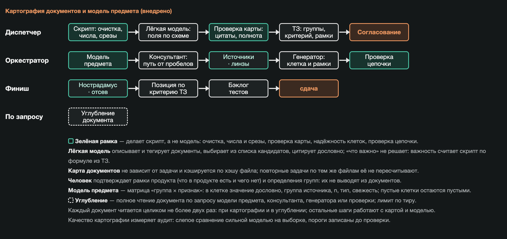

# Полигон гипотез

Система из нескольких ИИ-агентов проверяет продуктовые и маркетинговые идеи. Агент здесь — отдельный запуск модели со своей ролью: диспетчер выясняет задачу, оркестратор ведёт её до результата, остальные читают материалы, ищут в сети, проверяют и собирают итог. Незнакомые слова объяснены в разделе «Словарь» ниже.

**Для чего.** Ты приносишь идею и просишь её проверить. Система разбирает идею на утверждения, которые должны быть правдой, чтобы идея сработала, и проверяет каждое по твоим материалам и по сети. На выходе один документ: что в идее не так, где она слаба и как её усилить. Если без внутренних данных компании вопрос не закрыть, документ перечисляет возможные объяснения и предлагает проверку, которая покажет, какое из них верно.

## Как система проверяет идею

1. **Читает контекст.** Диспетчер сначала строит карту документов в `context/` одним скриптом: нумерует строки, размечает числа, срезы, продукт и риск и сводит в таблицу — модель до твоего согласия не работает. После согласования ТЗ лёгкая модель описывает каждый документ (кто говорит, сколько людей, слова это или поведение, что измерено) и цитирует по номерам строк. Скрипт проверяет, что цитаты дословны, а ни один файл и ни одно число не пропущены. Важность документов считает скрипт, не модель. Потом оркестратор собирает модель предмета: таблицу «группа × факт», где у каждой клетки надёжность считает скрипт, а пустые клетки остаются пустыми. ТЗ — техническое задание: короткий документ, где записано, что ты хочешь получить, о каких группах речь и что в продукте есть и чего нет. Доказательством считаются слова клиентов, данные и то, что реально случилось. Бриф команды и твоя собственная позиция проверяются так же, как сама идея. Если карты нет, работает прежний шаг: один агент читает всё целиком.
2. **Раскладывает идею.** Консультант берёт эту карту и варианты решения из ТЗ, формулирует 5–8 утверждений, которые должны быть правдой, чтобы идея сработала, и отмечает те, без которых она не работает. Дальше каждое утверждение проверяется отдельно.
3. **Ищет за и против.** Сначала твои материалы, потом сеть — отзывы, форумы, страницы конкурентов, отчёты. Под каждое утверждение есть запрос, который мог бы его опровергнуть. Три пересказа одной статьи считаются одним источником.
4. **Оставляет след.** Фрагмент, на котором стоит вывод, приводится дословно со ссылкой, и скрипт сверяет его с текстом источника. Число — с источником, периодом и формулой, если оно посчитано.
5. **Разводит роли.** Утверждения проверяет не тот агент, который их сформулировал. Ещё один агент смотрит отдельно, не зная рассуждений автора, держит ли найденный фрагмент тот вывод, который из него сделали.
6. **Называет неизвестное.** Исход по утверждению — подтверждается, опровергается или нет данных. Для «нет данных» — возможные объяснения, что косвенно говорит за каждое и какие данные покажут, какое верно. Мало данных — не ответ: по каждому ключевому вопросу система даёт лучшую версию с пометкой «оценка» и следующий шаг, который можно сделать самому. И не повод закончить: пока бюджет есть, ключевой вопрос, на который может ответить сеть, без поиска не сдаётся.
7. **Предлагает новое.** В задачах на гипотезы, план и ТЗ на доработку отдельная роль — Нострадамус — придумывает идеи, которых не было среди проверенных, когда ты их попросил или когда все проверенные гипотезы пришлось сузить или снять, а проверка отсеивает те, что материал опровергает. Оставшиеся идут в конец сдачи: «а ещё есть идеи; для следующего раунда понадобятся такие-то данные».
8. **Копит знание.** Материалы источников и результаты живых проверок возвращаются в `context/` для следующих задач. Выводы самой системы туда не попадают, чтобы в следующий раз она не приняла их за доказательство.

## Архитектура

### Картография документов и модель предмета

Контекст читается в два слоя, а важность документов и надёжность выводов считают скрипты, а не модель.

1. **Карта документов.** До согласования ТЗ — только скрипты: `map_docs.py` нумерует строки и размечает числа, срезы, продукт и риск, `map_summary.py` сводит это в таблицу для диспетчера. После согласования, первым шагом оркестратора, лёгкая модель (`document-mapper`) описывает каждый документ: кто говорит, сколько людей, слова это или поведение. Цитирует по номерам строк, `check_map.py` проверяет дословность и полноту.
2. **Модель предмета** (оркестратор). `rank_impact.py` выбирает документы для углубления (`document-deepener`), `subject-model` выписывает клетки «группа × признак» и рамки продукта, `build_model.py` считает надёжность клеток. Пустые клетки остаются пустыми.
3. **Дальше по маршруту.** Консультант строит путь от пустых и слабых клеток. Гипотеза называет клетку, рамку продукта и размер группы (`check_chain.py`). Порядок в позиции выводится из надёжности клеток (`check_rank.py`).

Что проверено. Полный маршрут с агентами прогонялся на реальных задачах: исследование по пачке интервью, задача на гипотезы и повторный прогон гипотез с линзами; что в каждом сломалось и что поправлено — в `system-notes.md`. Разметка документов проверена слепым аудитом на восьми документах; пороги аудита ещё не откалиброваны на двух-трёх задачах. Описание, пороги и риски — в [docs/proposal-document-dossiers.md](docs/proposal-document-dossiers.md). Механизмы, добавленные последними, — маршрут в коде, ворота шага, роли агентов, цена в ТЗ, выборочный аудит — проверены скриптами на выдуманных данных (`selftest.py`), в полном прогоне ещё не были.

## Что внутри

- `AGENTS.md` — инструкции для агентов: роли, принципы, правила. Главный документ: если что-то расходится, прав он.
- `CLAUDE.md` — одна строка `@AGENTS.md`: Claude Code читает только свой файл.
- `.claude/skills/` — двадцать пять скиллов, по одному на роль. Что каждый умеет и когда его звать — указатель `.claude/skills/orchestrator/registry.md`; контракт исполнителя — в конце его `SKILL.md`; маршруты оркестратора по типам выхода — `.claude/skills/orchestrator/routes/`, ядро оркестратора — его `SKILL.md`.
- `methodology/` — методология: указатель `tools-index.md` (какой инструмент под какую задачу), модули в `modules/` (список ниже) и `web-protocol.md` (как искать в сети и что считать надёжным источником).
- `context/` — материалы о продукте и клиентах, которые кладёшь ты.
- `tasks/` — задачи; папки создаёт система. В git из `context/` и `tasks/` попадают только `README.md`: сами материалы и задачи остаются локально.
- `scripts/` — проверки, которые не зависят от честности агента, и хуки Claude Code (`scripts/hooks/`, `.claude/settings.json`).
- `docs/` — схемы системы (четыре PNG) с HTML-исходниками в `docs/src/`, предложение по картографии документов `docs/proposal-document-dossiers.md`.
- `system-notes.md` — журнал замечаний к системе.

## Методология

Методология — это набор коротких модулей в `methodology/modules/` и указатель `methodology/tools-index.md`. Указатель говорит, какой инструмент брать под какой вопрос и какому исполнителю его передать. Исполнитель читает только нужный раздел, а не весь модуль.

| Модуль | О чём |
| --- | --- |
| M0–M8 | клиент и его задача, интервью, путь клиента и момент, когда ему становится невыносимо, почему клиент выбрал не нас, позиционирование, тексты сообщений, проверка формулировок и цены, каналы |
| M11–M13 | от цели бизнеса к конкретным действиям (дерево целей и расчёт «хватит ли клиентов на цель»), запуск и выбор масштаба задачи, рост |
| Э | эксперименты: нужен ли тест вообще, что записать до запуска, мог ли тест вообще увидеть эффект, как читать результат |
| Д | как просить данные у аналитика: что именно считать, что значит одна строка выгрузки, с каким числом сверить, как оформить принесённую выгрузку |
| К | как читать чужие отчёты и статьи: кто писал и зачем, как проверить цифры, где в статистике подвох |
| О | как оценивать величину без данных: прикидка по порядку величины, диапазон вместо точного числа, какой параметр сильнее всего влияет на итог (`scripts/sensitivity.py`) |
| П | как устроить акцию или кешбэк и посчитать, окупается ли она; сколько клиентов купили бы и без акции |
| Ж | что делать с клиентом на разных этапах (новый, активный, уснувший): онбординг, удержание, возврат, цепочки сообщений |
| С | как делить клиентов на группы по задаче, а не по описанию, и где проходит граница рынка |

Если в модуле раздел не опирается на источник, он помечен «синтез, проверять на данных»: система не выдаёт такое за проверенное знание.

## Кто что делает

| Роль | Задача |
| --- | --- |
| Диспетчер | Сначала картографирует документы в `context/`: скрипт размечает числа и срезы, лёгкая модель описывает каждый документ, скрипт проверяет цитаты и полноту. Потом превращает запрос в ТЗ: что ты хочешь получить, о каких группах клиентов речь, что в продукте есть и чего нет, какой результат будет. Задаёт три вопроса о том, что важнее всего уточнить. Если дело идёт к живой проверке, добавляет четвёртый, необязательный: сделать ли пробный прогон — задать будущие вопросы выдуманным респондентам и посмотреть, какие из них наводящие или непонятные (дольше и дороже, ничего не доказывает про реальных клиентов). Исполнителей диспетчер не выбирает |
| Человек | Отвечает на вопросы диспетчера (три, иногда четыре) и согласует ТЗ одним сообщением. Это единственная пауза во всей системе |
| Оркестратор | Ведёт задачу по шагам: решает, какого исполнителя позвать на каждый пункт пути, в каком порядке и когда остановиться. Строит модель предмета (таблицу «группа × факт») и выбирает документы для углубления. В задачах на гипотезы до генератора проходит вопрос через четыре линзы — когда, вместо нас, кто, что болит — и зовёт источники за внешним сырьём. После проверки по сути зовёт Нострадамуса и отсев его идей. Для каждого шага записывает, какой инструмент методологии взять из указателя. После шага запускает проверки и пишет журнал (лог) |
| Исполнители | Агенты с узкой работой: картограф документов (описывает и размечает файлы контекста, первый шаг после согласования ТЗ); углубление документа (читает важный документ целиком); модель предмета (таблица «группа × факт» и рамки продукта); разбор материалов (запасной шаг, когда карты нет); консультант (оценивает постановку и строит путь от «как сейчас» к «как нужно»: что должно стать известно); генератор гипотез; проверка по сути; планировщик; набор для проверки (скрипты и тексты для живой проверки); восемь источников данных (разбор интервью, сводка интервью, боли рынка, портрет аудитории, альтернативы, оценка рынка, путь клиента, разбор экспериментов); проверка смысла; Нострадамус (новые идеи вне колеи маршрута, лучшая версия там, где данных не хватило, и следующий шаг); сборщик итогового документа; писатель брифа; выдуманные респонденты (синтетика); сверка результатов |

К источникам данных оркестратор обращается по выбору, когда без ответа гипотезы или вердикт будут догадкой. Исключение — линзы: в задачах на гипотезы, план и ТЗ на доработку он до генератора решает по каждой из четырёх, звать ли источник за сырьём (путь клиента, альтернативы, портрет аудитории, боли рынка), и при открытой сети хотя бы один зовёт обязательно — иначе гипотезы вырастают из одного корня. Если ответ лежит внутри компании (воронка, выгрузка, итоги прошлой кампании), система не ищет его в сети: оркестратор пишет запрос аналитику и кладёт его в итоговую сводку отдельным блоком.

## Что можно получить

Что нужно, выбирает диспетчер по запросу, а ты подтверждаешь в ТЗ.

| Результат | Когда | Что на выходе |
| --- | --- | --- |
| Разбор | нужна оценка идеи или постановки | разбор консультанта |
| Гипотезы | нужно понять, что делать | гипотезы с вердиктами проверки, итоговая позиция (на что ставить и с чего начать), лучшая версия и следующий шаг по каждому ключевому вопросу, бэклог тестов и в конце — «а ещё есть идеи» для следующего раунда с данными, которые для них нужны |
| План проверки | нужно довести до действий | план и готовые материалы для живой проверки; если был пробный прогон — план уже поправлен по его находкам |
| Вердикты по проверке | принёс результаты живой проверки | вердикты по плану прошлой задачи |
| Валидация | принёс свою идею или гипотезы: «провалидируй» | документ `06-validation.md`: вердикт по идее, утверждения с «за» и «против» из твоих материалов и сети, что не так, где слабо и как усилить, как проверить, карта доверия |
| Исследование | нужно понять, что известно, без выбора решения: «собери исследование» | отчёт `06-research.md`: ответ по каждому вопросу, основания, стороны, карта доверия |
| ТЗ на доработку | нужно оценить идеи и наполнить их конкретикой: «составь ТЗ аналитику и редактору» | три коротких документа, с которыми можно сразу идти к людям: задача аналитику, бриф редактору со словами клиентов, список решений за тобой |

В списке вопросов ТЗ первым стоит твой вопрос твоими словами. Ключевые пункты помечены `[ключевой]`: по ним система ищет глубже. Решение, которое ты назвал принятым, помечено `[принято]`: система его не оспаривает, а проверяет только допущения внутри него. Строка «ЭКСПЕРИМЕНТ» отвечает, нужно ли вообще запускать тест, хватит ли решения на имеющихся данных или сначала нужна дешёвая замена. Строка «ЧТО ПОЛУЧИШЬ» заранее говорит, что будет в результате и где предел: какие вопросы без твоих данных останутся открытыми и чем их закрыть. Если дело идёт к живой проверке, диспетчер может предложить пробный прогон: система задаст будущие вопросы выдуманным респондентам и найдёт наводящие или непонятные. Это дольше и дороже, и реальных клиентов он заменить не может.

## Словарь

- **ТЗ** — техническое задание: короткий документ, где диспетчер записывает, что ты хочешь получить, чего не хватает и какой результат будет. Ты его согласуешь, и дальше система работает сама.
- **GAP** — список того, чего не хватает, чтобы достичь цели. Из него собираются вопросы задачи.
- **Пункт пути** — один шаг, который должен стать известен на дороге от «как сейчас» к «как нужно». Путь строит консультант.
- **Исполнитель** — агент с узкой работой: ищет, считает, проверяет или собирает документ.
- **Опора** — то, на чём стоит вывод: дословный фрагмент интервью, данные, случившееся. Утверждение команды опорой не считается.
- **Карта доверия** — раздел итогового документа: что держится на нескольких независимых источниках, что на одном, что стоит проверить руками.
- **Сдача** — итоговая сводка после работы: результат, что осталось неизвестным, запросы данных аналитику.
- **Карта документов** — пронумерованный текст каждого документа с тегами и досье: тип, про кого, сколько людей, что измерено, дата, выводы, числа и срезы, цитаты по номерам строк. Описывает документы и не оценивает их важность.
- **Модель предмета** — таблица знаний «группа × факт»: что известно про каждую группу, откуда, на сколько человек, слова это или поведение. Пустая клетка остаётся пустой.
- **Надёжность клетки** — значение, версия, идея или нет данных. Считается скриптом: совпала ли группа источника с группой строки, указан ли размер, поведение это или слова.
- **Рамки продукта** — что в продукте есть и чего нет (форма кешбэка, лимиты, виды карт, выгрузки). Механика, которой в продукте нет, гипотезой не становится.
- **Пробный прогон** — проверка скрипта живой проверки на выдуманных респондентах до реальных звонков. Находит наводящие и непонятные вопросы и ветки теста, которые ничего не различат. О реальных клиентах ничего не доказывает, но его находки правят бэклог или план до старта.
- **Линзы** — четыре вопроса, через которые оркестратор пропускает задачу до генератора: когда (путь клиента), вместо нас (альтернативы), кто (портрет аудитории), что болит (боли рынка). Нужны, чтобы гипотезы строились не только из своих материалов, но и из внешнего сырья.
- **Нострадамус** — роль в конце маршрута: придумывает новые идеи вне проверенного набора и даёт лучшую версию ответа там, где данных не хватило. Его идеи — оценка, а не опора.
- **Отсев идей** — проверка идей Нострадамуса на то, не убивает ли их материал. Двух опор не требует: новые идеи по определению держатся на малом.
- **Следующий раунд** — новое ТЗ по той же теме: диспетчер берёт в него идеи, прошедшие отсев, и данные, которые для них нужны.
- **Синтетика** — всё, что придумано моделью: выдуманные респонденты, выдуманные отчёты. Свидетельством не считается никогда.
- **Полигон** — набор выдуманных отчётов об экспериментах, где правильные ответы известны заранее. Проверяет, не ошибается ли сам навык разбора.
- **Тир** — масштаб задачи по тому, насколько ответ изменит разговор с клиентом; от него зависит, сколько шагов по выбору система может потратить.
- **Ёмкость** — строка ТЗ: сколько проверок ты реально запустишь за 2 недели. Тестов в бэклоге и новых идей в сдаче — не больше ёмкости плюс одна: остальное — строкой «в очереди».
- **Цена** — строка ТЗ: сколько вызовов агентов и токенов уйдёт на весь маршрут. Свободная часть — шаги, которые выбирает оркестратор; резерв — обязательные вызовы (разметка документов, проверка смысла, Нострадамус и другие); потолок — после него система останавливается. Считает скрипт по трассам прошлых задач.

## Проверки

Что можно проверить скриптом, проверяет скрипт. Скрипт гарантирует форму — цитата есть в источнике, поле заполнено, — но не смысл: держит ли цитата вывод, видят проверка смысла и выборочный аудит (три случайных места на итоговый документ сверяет отдельный агент; те же места есть в сдаче, чтобы ты мог проверить сам). После каждого шага оркестратор запускает проверки одной командой — `route.py done`. Проверку смысла делает отдельный агент в своём контексте: по вердиктам проверки по сути, по итоговому документу и по источнику, на котором стоит ключевой пункт пути. Перед окончанием ответа Stop-хук ещё раз прогоняет цитаты и числа и не даёт закончить, пока ошибки не исправлены или не перечислены.

| Скрипт | Что делает |
| --- | --- |
| `add_source.py` | регистрирует источник задачи в `sources.csv`, сохраняет сырой текст; страницу скачивает сам (`--fetch`) |
| `check_quotes.py` | цитата «…» [F-id] должна найтись в сыром тексте именно своего источника; считает, сколько источников не пересказывают друг друга; замечает цитаты без id, ссылки вне реестра, опору на утверждения команды |
| `add_number.py` | регистрирует число в `numbers.csv`: факт — с фрагментом в источнике, производное — только формулой с пересчётом, допущение — с причиной |
| `check_numbers.py` | число рядом со ссылкой [N-id]; разные значения при одинаковых условиях — противоречие, при разных — нет |
| `check_artifact.py` | артефакт шага не пуст и не заменён резюме; исполнитель не тронул чужие файлы; на блокирующие замечания проверки смысла есть ответы; блок счёта опор перенесён дословно |
| `list_unused.py` | источники, найденные на шаге, но не процитированные: вход для проверки смысла |
| `trust_map.py` | считает опоры для карты доверия |
| `review_format.py` | общий разбор отчёта проверки смысла и ответов автора: им пользуются `check_artifact.py` и `trust_map.py`, счёт не расходится |
| `check_private.py` | персональные данные (имена из `private.txt`, телефоны, e-mail, ИНН, карты) в артефактах и в логе; закрытые для веба слова из `closed-web.txt` в журналах запросов; найденное в отчёт не копируется |
| `check_step.py` | все проверки после шага одной командой: `check_artifact`, `check_quotes`, `check_private`, `check_numbers`; одна строка для лога со счётчиками, подробности — только по ошибкам |
| `check_effort.py` | «мало данных» — не выход: ключевой вопрос, на который может ответить сеть, не сдаётся без поиска, пока бюджет есть; если всё сужено — сдача начинается с того, какие данные нужны; идей в сдаче не больше, чем человек успеет проверить, плюс одна |
| `check_forecast.py` | Нострадамус: режим совпадает с условием; в режиме с новыми идеями — не меньше пяти, у каждой «не повторяет», «уточнит», первый шаг и «на чём» (поле источника с id или новый сбор); рамка сверена, по каждому ключевому вопросу есть лучшая версия с пометкой «оценка», альтернатива, что их различит и следующий шаг; «нет данных» вместо версии — ошибка |
| `check_ideas.py` | отсев новых идей: вердикт по каждой (кажется валидной / переделать первый шаг / снять), «Возражения» отдельным полем, выполнимость первого шага, у живых — данные для следующего раунда, снятые — с причиной, а не за «нет опор» |
| `check_rehearsal.py` | пробный прогон на синтетике родил следствия: у каждого теста статус (как есть / после правки / не запускать), что меняется в решении, что подсказали персоны; в бэклоге или плане ответ на каждое следствие |
| `check_knowledge.py` | разбор материалов: каждый файл контекста в таблице покрытия, по каждому пункту GAP есть раздел и «чего нет» |
| `map_docs.py` | картография документов: нумерует строки текста, собирает таблицы по ячейкам, размечает теги «число», «срез», «продукт», «риск»; карта кэшируется по хэшу файла |
| `map_summary.py` | сводка карты без модели — для ТЗ: какие документы, что не читается, какие срезы встречаются, строки про продукт |
| `check_map.py` | досье документов: блок на каждый файл, все поля, цитаты адресны и дословны по номеру строки, строки с числами учтены или отброшены с причиной, оценки важности в досье нет |
| `rank_impact.py` | важность документов по формуле, а не по суждению модели; кандидаты на углубление с лимитом по тиру |
| `build_model.py` | модель предмета: матрица «группа × признак»; надёжность клетки (значение, версия, идея, нет данных) считает скрипт; пустые и слабые клетки |
| `check_chain.py` | у каждой гипотезы есть клетка модели, рамка продукта со статусом «есть» и размер группы с числом |
| `check_rank.py` | порядок направлений в позиции выводится из надёжности клеток; клетки без данных не ранжируются |
| `check_path.py` | каждый пункт GAP привязан к пути консультанта или стоит «вне пути» с причиной; с `--plan` — каждый вариант решения покрыт, есть пункт на проверку допущения; перед сдачей — у каждого пункта пути есть исход |
| `check_log_sources.py` | в задачах на гипотезы перед генератором — блок ЛИНЗЫ (когда, вместо нас, кто, что болит: зову или не нужно с причиной); у каждого шага-источника в логе записаны вопрос, зачем он нужен и что по нему уже известно; указан инструмент методологии из указателя (или «—») |
| `check_fresh.py` | старый веб-источник процитирован с годом |
| `check_long_list.py` | отсев длинного списка гипотез по правилам, записанным заранее |
| `pdf_to_images.py` | сохраняет страницы PDF картинками, когда у файла нет текстового слоя: агент читает их и передаёт расшифровку в `add_source.py` с `--read partial` |
| `check_env.py` | что установлено для чтения файлов и доступна ли сеть |
| `trust_block.py` | вспомогательный модуль: блок «СЧЁТ ОПОР», который переносится в отчёт дословно, не разбирается проверками чисел и свежести |
| `polygon.py` | полигон: выдуманные отчёты об экспериментах с ключом ответов и сверка навыка разбора экспериментов (без нейросети) |
| `sensitivity.py` | чувствительность формулы из реестра чисел: какой параметр сильнее всего двигает итог (методология О) |
| `check_readable.py` | документы для людей — брифы, итоговая позиция, документ валидации — читаются без знания системы: нет номеров гипотез, слов системы, кодов выгрузок; соблюдены лимиты размера |
| `check_publish.py` | перед отправкой на GitHub ищет в файлах и сообщениях коммитов имена и закрытые слова из задач и из `.publish-stopwords`; нашёл — отправка останавливается |
| `hooks/guard_writes.py` | хук: подагентам закрыта запись в систему, реестр и `context/`; в Bash — только скрипты системы и чтение; сеть — только ролям с сетью |
| `data_block.py` | блоки данных в артефактах: машинная часть — JSON по схеме, а не текст под регулярку; разбирают их те же проверки |
| `route.py` | маршрут в коде: какой шаг идёт, что он изменил (по хэшам файлов), какие обязательные шаги впереди, готова ли сдача; продолжение после обрыва |
| `hooks/step_gate.py` | хук: агент не сдаёт результат с ошибками проверок, пока один раз не попробовал их исправить |
| `roles.py` | таблица ролей: модель, доступ к сети, инструменты; из неё собраны описания агентов в `.claude/agents/` |
| `hooks/stop_check.py` | хук: проверка цитат и чисел перед окончанием ответа |
| `hooks/trace.py` | хук: расход каждого агента и основной сессии — токены, время, фактическая модель — из транскриптов |
| `trace_summary.py` | сводка расхода задачи; строка «Расход» за шаг; версия системы для лога |
| `cost_estimate.py` | строка ЦЕНА для ТЗ и остаток бюджета по ходу задачи |
| `selftest.py` | самопроверка всех скриптов |

## Чтение файлов

`add_source.py` читает `.docx`, `.xlsx`, `.pptx`, `.pdf`, текст и страницы по адресу. С PDF помогают необязательные пакеты из `requirements.txt` (`pip install -r requirements.txt`): PyMuPDF и pypdf читают текст, PyMuPDF ещё выгружает страницы в картинки. Слайды-картинки и сканы без текстового слоя скрипт отклоняет с подсказкой: `scripts/pdf_to_images.py` сохраняет страницы, агент читает их и передаёт расшифровку с `--read partial`. Что установлено, показывает `python3 scripts/check_env.py`.

## Где запускать

| Среда | Инструкции | Скиллы |
| --- | --- | --- |
| Claude Code | `CLAUDE.md` → `AGENTS.md` | находит в `.claude/skills/` сам |
| OpenCode | `AGENTS.md` | находит в `.claude/skills/` сам |
| Codex, Cursor и другие | `AGENTS.md` | если среда не нашла скиллы — `AGENTS.md` велит читать их по пути напрямую |

Систему писали под Claude. На других моделях она работает, но результат зависит от того, справляется ли модель с длинными инструкциями. Агенты работают в отдельных контекстах только там, где среда даёт подагентов; без них все роли по очереди исполняет один агент, и правило «кто строит, тот не проверяет» выполняется не полностью.

Что держится только в Claude Code: хуки — запрет правок системы по ходу задачи, права подагентов в Bash и сети, запись только в артефакт идущего шага, возврат ошибок исполнителю до сдачи, трасса расхода, проверка цитат перед окончанием ответа — и описания агентов в `.claude/agents/` с моделью и инструментами роли. В других средах скрипты (`route.py`, проверки, `cost_estimate.py`) работают, только если их запускает сама модель по инструкции: заставить её некому.

## Как начать

1. Открой Claude Code в корне проекта, где лежит `AGENTS.md`: хуки и скиллы подгружаются оттуда. Если сменил папку посреди сессии, открой новую.
2. Положи в `context/` что есть о продукте и клиентах — что именно, написано в `context/README.md`.
3. `/dispatcher` и задача — или «диспетчер, …», если в среде нет слеш-команд.
4. Ответь на вопросы диспетчера (три; четвёртый, про пробный прогон, только если он применим) и согласуй ТЗ одним сообщением. Проверь, что первым пунктом стоит твой вопрос, и прочитай строки «ЧТО ПОЛУЧИШЬ» и «ЦЕНА»: цена — сколько вызовов агентов и токенов уйдёт на маршрут; первые задачи считаются по замеру, дальше — по трассам твоих прошлых задач. Дальше система идёт сама до сдачи.
5. После живой проверки возьми заготовки из `tasks/<задача>/results-templates/`, заполни и положи в `tasks/<задача>/results/`, потом напиши диспетчеру.
6. Запросы данных из сдачи отдай аналитику, ответ положи в `context/` и напиши диспетчеру: он пересоберёт ТЗ.

## Если правишь систему

- Хуки не дают править скиллы и скрипты по ходу задачи. Перед правкой создай в корне пустой файл `.polygon-dev`, после — удали.
- После любой правки в `scripts/` запусти `python3 scripts/selftest.py`.
- Один раз в своей копии включи проверку перед отправкой: `git config core.hooksPath scripts/git-hooks`. Свои закрытые слова — названия продуктов, компаний, партнёров — впиши в `.publish-stopwords` по одному в строке; файл в репозиторий не попадает.
- В репозиторий — только система. Примеры в инструкциях и тестах только выдуманные.
- CI (`.github/workflows/selftest.yml`) на каждый пуш: `selftest.py`, размеры инструкций, реестр правил, описания агентов, полигон разметки и проверка перед отправкой. Стоп-слова для неё в CI — секрет репозитория `PUBLISH_STOPWORDS` (слова построчно).
- Полигон для навыков: `polygon.py make` / `score` — отчёты об экспериментах; `make-interviews` / `score-interviews` — выдуманные транскрипты с заложенными сигналами (обход, триггер, слова против поведения, альтернатива, цена, барьер) для разбора интервью; `map-recall` — полнота разметки документов, без нейросети. Результат прогона навыка на полигоне — в `system-notes.md` с хэшем коммита.
- Тесты по цене: сначала `python3 scripts/selftest.py` (бесплатно), потом полигон (`scripts/polygon.py`: выдуманные отчёты об экспериментах с известными ответами, для одного вызова навыка), всю цепочку — перед слиянием крупных правок.
- Схемы — четыре PNG в `docs/`, исходники всех — HTML в `docs/src/`: после изменений в системе правь HTML и пересними PNG (команда в `docs/README.md`).
- Правило системы — с id. Новое правило: `python3 scripts/rules.py --assign` даст id и строку в `methodology/rules.csv`; заполни в ней «прогон» (запись `system-notes.md`, из которой оно родилось) и «регрессия» (тест в `selftest.py`, сценарий полигона или «только прогон») — без них `rules.py --check` не пройдёт. Сколько раз правило меняло решение — `rules.py --usage` по логам задач; правило без срабатываний за пять прогонов своих типов — кандидат на удаление: удаляешь id из текста, в реестре ставишь «удалено» и причину.
- Размеры инструкций держит `python3 scripts/check_size.py`: новое правило либо помещается в порог, либо вытесняет старое, либо уезжает в файл, который читается по требованию.
