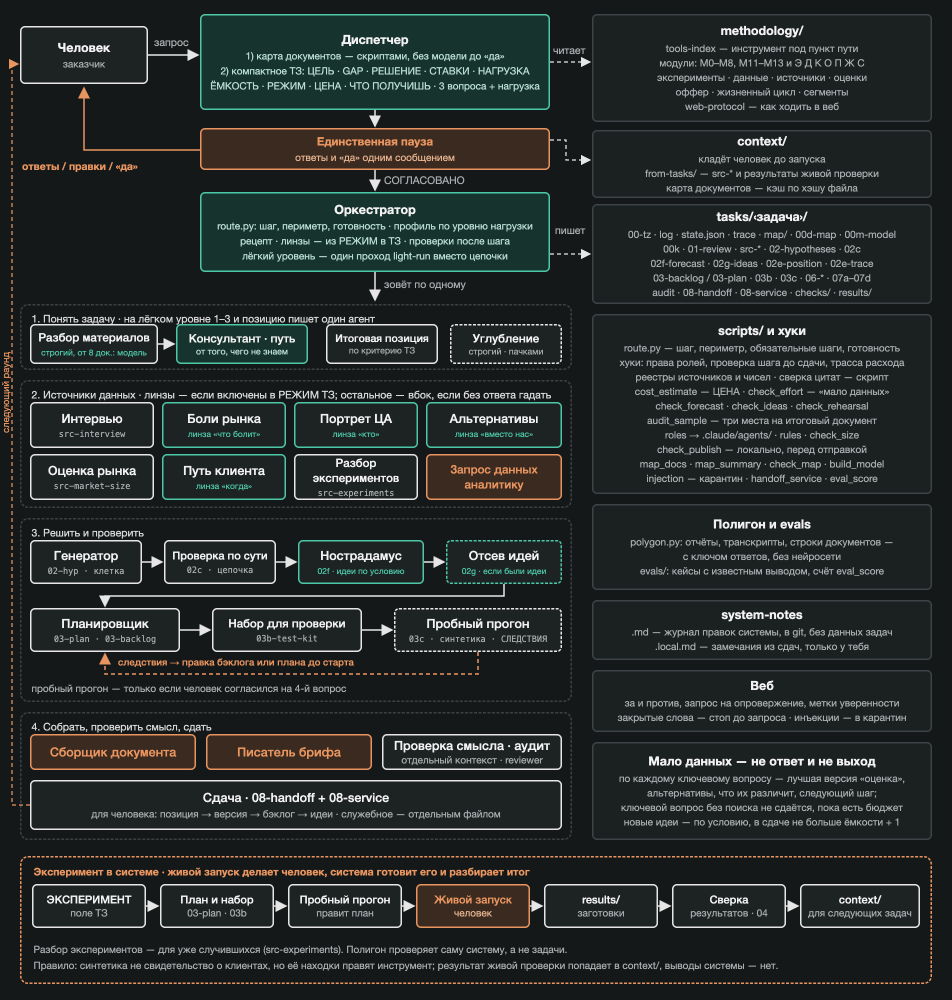
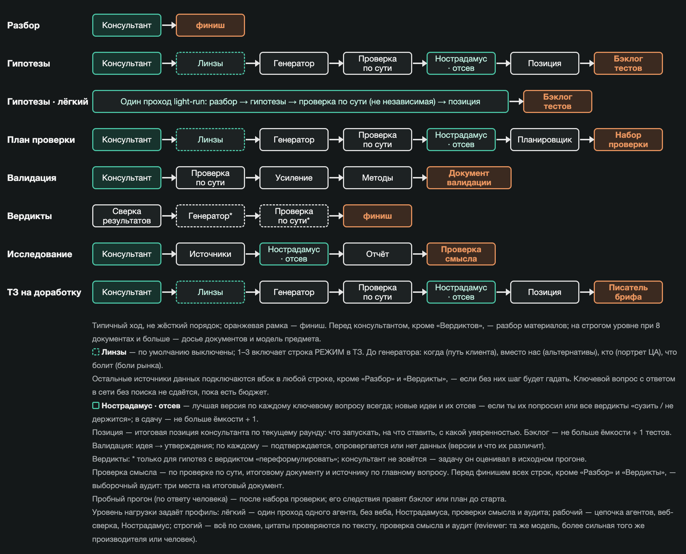
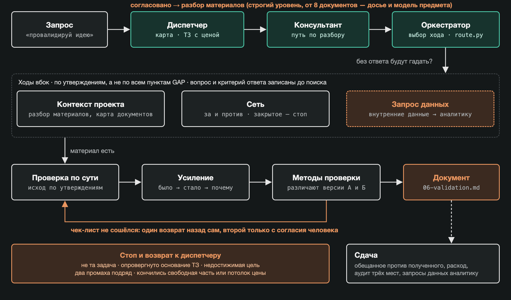
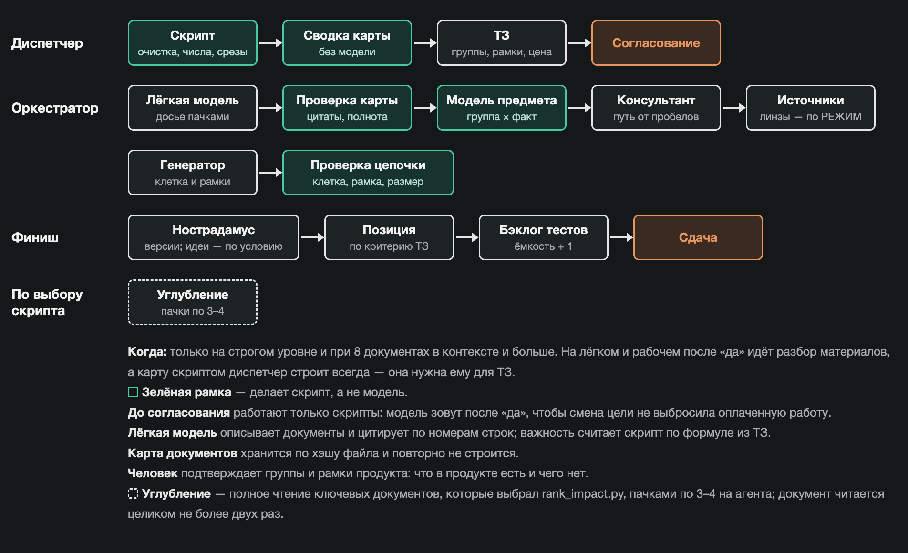

# Полигон гипотез

Система агентов для работы с продуктовыми и маркетинговыми гипотезами. Она отсеивает слабые идеи, усиливает перспективные проверкой по твоим материалам и по сети и готовит живую проверку: кому, что и как показать. Подтверждает гипотезу только живая проверка. Выдуманные респонденты нужны лишь для поиска дефектов теста до старта. Агент здесь — отдельный запуск модели со своей ролью: диспетчер выясняет задачу, оркестратор ведёт её до результата, остальные читают материалы, ищут в сети, проверяют и собирают итог. Незнакомые слова объяснены в «Словаре» ниже.

**Для чего.** Например, ты приносишь идею и просишь её проверить. Система раскладывает идею на утверждения, которые должны быть правдой, чтобы она сработала, и проверяет каждое по твоим материалам и по сети. На выходе один документ: что в идее не так, где она слаба и как её усилить. Если вопрос не закрыть без внутренних данных компании, документ перечисляет возможные объяснения и предлагает проверку, которая покажет, какое из них верно.

## Как система проверяет идею

1. **Читает контекст.** До твоего согласия работают только скрипты: они нумеруют строки документов в `context/`, размечают числа, срезы, продукт и риск и сводят всё в таблицу для диспетчера. После согласования ТЗ на лёгком и рабочем уровне материалы читает один агент: по каждому вопросу ТЗ — что уже известно дословно, что противоречит, чего нет. На строгом уровне при восьми документах и больше лёгкая модель описывает каждый документ — кто говорит, сколько людей, слова это или поведение, что измерено — и цитирует по номерам строк. Скрипт проверяет, что цитаты дословны и ни один файл и ни одно число не пропущены; важность документов тоже считает скрипт. Фразы внутри материалов, обращённые к ИИ («игнорируй инструкции…»), не исполняются: скрипт уводит их в карантин и помечает источник.
2. **Отделяет факты от утверждений.** Доказательством считаются слова клиентов, данные и то, что реально случилось. Бриф команды и твоя собственная позиция проверяются так же, как сама идея. На строгом уровне при большом контексте оркестратор ещё собирает модель предмета — таблицу «группа × факт»: надёжность каждой клетки считает скрипт, пустые клетки остаются пустыми. Разбор материалов заканчивается таблицей ключевых находок: до двенадцати строк, у каждой дословная опора. `check_carry.py` следит, чтобы находка не пропала до сдачи: в `08-service.md` у каждой записано, вошла она в сдачу или снята и почему. Это работает в цепочке агентов (типы «гипотезы», «план проверки», «ТЗ на доработку»), в одиночном проходе — нет. Если в контексте три отчёта о тестах и больше, до генератора обязателен разбор тестов. Параметр профиля `audit=on` (по умолчанию выключен) добавляет до генератора аудит находок: проверка по сути сверяет их с первичными файлами.
3. **Раскладывает идею.** Консультант берёт разбор материалов (или модель предмета) и варианты решения из ТЗ, формулирует 5–8 утверждений, которые должны быть правдой, чтобы идея сработала, и отмечает те, без которых она точно не работает. Дальше каждое утверждение проверяется отдельно.
4. **Ищет за и против.** Сначала твои материалы, потом сеть — отзывы, форумы, страницы конкурентов, отчёты. Под каждое утверждение есть запрос, который мог бы его опровергнуть. Три пересказа одной статьи считаются одним источником. Запрос с персональными данными или закрытыми словами задачи хук останавливает до отправки в сеть.
5. **Оставляет след.** Фрагмент, на котором стоит вывод, приводится дословно со ссылкой, и скрипт сверяет его с текстом источника. Посчитанное число идёт с источником, периодом и формулой.
6. **Разводит роли.** Утверждения проверяет не тот агент, который их сформулировал. Ещё один агент, не видя рассуждений автора, смотрит, держит ли найденный фрагмент сделанный из него вывод. Исключение — лёгкий уровень: ради скорости разбор, гипотезы, их проверку, позицию и бэклог пишет один агент за один проход, и сдача прямо говорит, что проверка не независима.
7. **Называет неизвестное.** Исход по утверждению — подтверждается, опровергается или нет данных. Для «нет данных» — возможные объяснения, что косвенно говорит за каждое и какие данные покажут, какое верно. По каждому ключевому вопросу система даёт лучшую версию с пометкой «оценка» и следующий шаг, который можно сделать самому. Нехватка данных не останавливает работу: пока бюджет есть, ключевой вопрос, на который может ответить сеть, без поиска не сдаётся.
8. **Предлагает новое.** В задачах на гипотезы, план и ТЗ на доработку Нострадамус придумывает идеи, которых не было среди проверенных, — если ты их попросил или если все проверенные гипотезы пришлось сузить или снять. Проверка отсеивает те, что опровергает материал. Оставшиеся идут в конец сдачи вместе с данными, которые понадобятся для следующего раунда. В валидации твоих гипотез система своих вместо них не строит, но если проверка нашла версию, в которую не целится ни одна твоя гипотеза, Нострадамус превращает её в одну–три идеи; прошедшие отсев — в конце сдачи разделом «Замечено вне ваших гипотез», не больше двух, с пометкой «оценка, не проверено».
9. **Копит знание.** Материалы источников и результаты живых проверок возвращаются в `context/` для следующих задач. Выводы самой системы туда не попадают, чтобы в следующий раз она не приняла их за доказательство.

## Нагрузка: уровни и профиль прогона

В начале задачи ты выбираешь нагрузку: сколько работы и какой строгости ты хочешь. Диспетчер рекомендует уровень по объёму контекста и цене ошибки и показывает, что на каждом уровне будет сделано, что ты получишь и чего не будет. Минут и токенов он не обещает: ожидание описано словами, а продолжительность прогона — «короткий», «средний» или «долгий».

| Уровень | Когда | Что получишь | Чего не будет |
| --- | --- | --- | --- |
| Быстро | ответ укладывается в пару шагов | готовый ответ и несколько идей, без исполнителей | проверки выводов про рынок и факты |
| Лёгкий (К5, К4) | контекста нет или мало, цена ошибки низкая | пул гипотез с дешёвыми тестами за один проход одного агента; проверка по методологии | подтверждения источниками и независимой проверки: выводы остаются гипотезами; на большом контексте ключевые находки из материалов могут не дойти до сдачи — ТЗ об этом предупреждает |
| Рабочий (баланс) | контекст средний | то же плюс сверка внешних фактов в вебе, лучшие версии ответов и выборочная проверка смысла в трёх местах | блокирующей дословной проверки цитат и полного независимого аудита |
| Строгий (Т4, Т5) | материалов много, или результат увидят другие, или решение трудно отменить | цитаты, проверенные по тексту, независимая проверка смысла, аудит | широты: идей меньше |

Это одна шкала «креатив ↔ точность»: чем больше у тебя материалов, тем выше точность и ниже креатив; нет контекста — точность на минимуме. Выбранный уровень оркестратор превращает в профиль прогона (ширина генерации, строгость опор, уровень проверки, Нострадамус, число линз, одиночный проход или цепочка агентов, кто проверяет смысл, аудит находок): профиль записывается командой `route.py profile`, объясняется в логе и меняет список обязательных шагов, готовность и то, блокируют ли цитаты, свежесть источников и числа. Строже, чем позволяет контекст, уровень не рекомендуется: без твоих данных опоры не появятся. Нет профиля — работает прежний полный маршрут. Подробности и таблицы параметров — в [INFRASTRUCTURE.md](INFRASTRUCTURE.md); стартовые наборы шагов — в `.claude/skills/orchestrator/recipes.md`.

## Архитектура

### Карта документов и модель предмета

Эта ветка работает только на строгом уровне и при восьми документах в контексте и больше: на малом контексте таблица «группа × признак» остаётся почти пустой, а стоит десятки вызовов. На лёгком и рабочем уровне вместо неё идёт разбор материалов (`context-reader`); на лёгком при одиночном проходе материалы читает сам агент прохода. Карту скриптами диспетчер строит всегда — она нужна ему для ТЗ.

Контекст читается в два слоя. Важность документов и надёжность выводов считают скрипты, а не модель.

1. **Карта документов.** До согласования ТЗ — только скрипты: `map_docs.py` нумерует строки и размечает числа, срезы, продукт и риск, `map_summary.py` сводит это в таблицу для диспетчера. После согласования лёгкая модель (`document-mapper`) пачками описывает документы и цитирует по номерам строк; `merge_map.py` склеивает пачки, `check_map.py` проверяет дословность и полноту.
2. **Модель предмета.** `rank_impact.py` выбирает документы для углубления (`document-deepener`, по 3–4 документа на агента), `subject-model` выписывает клетки «группа × признак» и рамки продукта, `build_model.py` считает надёжность клеток.
3. **Дальше по маршруту.** Консультант строит путь от пустых и слабых клеток. Гипотеза называет клетку, рамку продукта и размер группы (`check_chain.py`). Порядок направлений в итоговой позиции выводится из надёжности клеток (`check_rank.py`).

## Что внутри

- `AGENTS.md` — инструкции для агентов: роли, принципы, правила. Если что-то расходится, прав он.
- `CLAUDE.md` — одна строка `@AGENTS.md`: Claude Code читает только свой файл.
- `.claude/skills/` — двадцать шесть скиллов: по одному на роль и одиночный проход лёгкого уровня (`light-run`). Указатель исполнителей — `.claude/skills/orchestrator/registry.md`; контракт исполнителя — в конце его `SKILL.md`. У оркестратора ядро — его `SKILL.md`, маршруты по типам выхода — в `routes/`.
- `.claude/agents/` — описания агентов: модель и инструменты каждой роли.
- `methodology/` — указатель инструментов `tools-index.md`, модули в `modules/` (список ниже), `web-protocol.md` (как искать в сети и что считать надёжным источником) и реестр правил `rules.csv`.
- `context/` — материалы о продукте и клиентах, которые кладёшь ты.
- `tasks/` — задачи; папки создаёт система. Из `context/` и `tasks/` в git попадают только `README.md`, сами материалы и задачи остаются у тебя.
- `scripts/` — проверки, которые не зависят от честности агента, и хуки Claude Code (`scripts/hooks/`, `.claude/settings.json`).
- `evals/` — замороженные кейсы с известным ответом и `eval_score.py`: мерят не форму, а пришла ли система к верному выводу. Настоящие кейсы лежат только локально в `evals/cases-local/`.
- `docs/` — четыре схемы системы с HTML-исходниками в `docs/src/` и предложение по картографии документов.
- `INFRASTRUCTURE.md` — уровни нагрузки, параметры профиля, раздельная сдача, известные ограничения.
- `system-notes.md` — журнал правок системы, без данных задач. Замечания из сдач оркестратор пишет в локальный `system-notes.local.md`, в git он не попадает.

## Методология

Методология — набор коротких модулей в `methodology/modules/` и указатель `methodology/tools-index.md`. Указатель говорит, какой инструмент брать под какой вопрос и какому исполнителю его передать. Исполнитель читает только нужный раздел.

| Модуль | О чём |
| --- | --- |
| M0–M8 | клиент и его задача, интервью, путь клиента и момент, когда ему становится невыносимо, почему клиент выбрал не нас, позиционирование, тексты сообщений, проверка формулировок и цены, каналы |
| M11–M13 | от цели бизнеса к действиям (дерево целей и расчёт «хватит ли клиентов на цель»), запуск и выбор масштаба задачи, рост |
| Э | эксперименты: нужен ли тест, что записать до запуска, мог ли тест увидеть эффект, как читать результат |
| Д | как просить данные у аналитика: что считать, что значит одна строка выгрузки, с каким числом сверить, как оформить принесённую выгрузку |
| К | как читать чужие отчёты и статьи: кто писал и зачем, как проверить цифры, где в статистике подвох |
| О | как оценить величину без данных: прикидка по порядку, диапазон вместо точного числа, какой параметр сильнее всего влияет на итог (`scripts/sensitivity.py`) |
| П | как устроить акцию или бонус и посчитать, окупается ли она; сколько клиентов купили бы и без акции |
| Ж | что делать с клиентом на разных этапах (новый, активный, уснувший): онбординг, удержание, возврат, цепочки сообщений |
| С | как делить клиентов на группы по задаче, а не по описанию, и где проходит граница рынка |

Раздел модуля без источника помечен «синтез, проверять на данных»: система не выдаёт такое знание за проверенное.

## Кто что делает

| Роль | Задача |
| --- | --- |
| Диспетчер | Скриптами строит карту документов в `context/` и превращает запрос в ТЗ: что ты хочешь получить, о каких группах клиентов речь, что в продукте есть и чего нет, какой будет результат и сколько он стоит. Показывает компактное ТЗ и задаёт три вопроса о самом важном; в задачах на гипотезы и планы один из них — сколько проверок ты запустишь за 2 недели. Четвёртым обязательно спрашивает про нагрузку. Если дело идёт к живой проверке, пятым предлагает пробный прогон на выдуманных респондентах: дольше и дороже, о реальных клиентах ничего не доказывает. После «да» в приложении Claude открывает для маршрута новую сессию и оставляет на неё ссылку. Исполнителей не выбирает |
| Человек | Отвечает на вопросы диспетчера и согласует ТЗ одним сообщением. Это единственная пауза во всей системе |
| Оркестратор | Ведёт задачу по шагам: решает, какого исполнителя позвать на каждый пункт пути, в каком порядке и когда остановиться. Выбирает профиль прогона по уровню нагрузки и подбирает шаги по рецепту. Каждый шаг регистрирует в `route.py`, после шага запускает проверки и пишет лог. Первым шагом зовёт разбор материалов (на строгом уровне при большом контексте — строит модель предмета), на лёгком уровне — один агент на весь проход. Линзы до генератора — только если их включил РЕЖИМ в ТЗ. После проверки по сути зовёт Нострадамуса, перед сдачей — выборочный аудит |

**Исполнители** — агенты с узкой работой:

- документы: картограф (описывает и размечает файлы контекста, первый шаг после согласования), углубление документа, модель предмета, разбор материалов (когда карты нет);
- цепочка: консультант (оценивает постановку и строит путь от «как сейчас» к «как нужно»), генератор гипотез, проверка по сути, планировщик, набор для проверки (скрипты и тексты для живой проверки);
- одиночный проход: на лёгком уровне один агент пишет разбор, гипотезы, проверку по сути, позицию и бэклог за один вызов вместо цепочки;
- источники данных: разбор интервью, сводка интервью, боли рынка, портрет аудитории, альтернативы, оценка рынка, путь клиента, разбор экспериментов;
- проверка и финиш: проверка смысла, Нострадамус, сборщик итогового документа, писатель брифа, выдуманные респонденты (синтетика), сверка результатов.

Источники данных оркестратор зовёт по выбору — когда без ответа гипотезы или вердикт будут догадкой. Линзы — ходы к источникам за сырьём до генератора (путь клиента, альтернативы, портрет аудитории, боли рынка) — по умолчанию выключены. Их число (1–3) ставит строка РЕЖИМ в ТЗ: диспетчер пишет одну линзу, когда контекста нет или мало и вопрос про пространство вариантов, две-три — по твоей просьбе. Оркестратор сам число линз не повышает. Если ответ лежит внутри компании (воронка, выгрузка, итоги прошлой кампании), в сети его не ищут: оркестратор пишет запрос аналитику отдельным блоком сдачи.

## Что можно получить

Тип результата выбирает диспетчер по запросу, ты подтверждаешь его в ТЗ.

| Результат | Когда | Что на выходе |
| --- | --- | --- |
| Разбор | нужна оценка идеи или постановки | разбор консультанта |
| Гипотезы | нужно понять, что делать | гипотезы с вердиктами, итоговая позиция (на что ставить и с чего начать), лучшая версия и следующий шаг по каждому ключевому вопросу, бэклог тестов; если были новые идеи — в конце они и данные, которые для них нужны |
| План проверки | нужно довести до действий | план и готовые материалы для живой проверки; если был пробный прогон — план уже поправлен по его находкам |
| Вердикты по проверке | ты принёс результаты живой проверки | вердикты по плану прошлой задачи |
| Валидация | ты принёс свою идею или гипотезы: «провалидируй» | документ `06-validation.md`: вердикт по идее, утверждения с «за» и «против» из твоих материалов и сети, что не так, где слабо и как усилить, как проверить, карта доверия; в сдаче — до двух идей вне твоих гипотез, если проверка их нашла |
| Исследование | нужно понять, что известно, без выбора решения: «собери исследование» | отчёт `06-research.md`: ответ по каждому вопросу, основания, стороны, карта доверия |
| Карта направлений | нужно понять, куда можно пойти, и пока ничего не запускаешь: «как подойти», «хочу разобраться» | `06-directions.md`: как делить клиентов или задачу, 8–15 направлений — у каждого на чём стоит, версия с уверенностью, что её различит, первый шаг и что её убьёт; с чего начать |
| ТЗ на доработку | нужно оценить идеи и наполнить их конкретикой: «составь ТЗ аналитику и редактору» | три коротких документа, с которыми можно сразу идти к людям: задача аналитику, бриф редактору со словами клиентов, список решений за тобой |

Сдача лежит в трёх файлах: `08-handoff.md` — только для тебя, `08-sources.md` — источники выводов и `08-service.md` — всё служебное (путь, чек-лист, расход, опоры, замечания к системе). `08-handoff.md` начинается с «Что я рекомендую сделать»: у каждого действия — на какой твой вопрос оно отвечает, почему (что выяснили, с цитатой), цена, первый шаг и когда от него откажешься; запрос данных идёт следом, а не вместо рекомендации. Дальше — что запускать, что обещал уровень и что сделано, раздел «Что лежит в папке задачи». Источники в тексте для тебя названы коротко (сайт или тип материала); ссылки, насколько им верить и сколько найденного в сети дошло до выводов — в `08-sources.md`. Механическую часть служебной сдачи собирает скрипт `handoff_service.py` из лога и проверок; оркестратор пишет только разделы, где нужно суждение.

В списке вопросов ТЗ первым стоит твой вопрос твоими словами. Ключевые пункты помечены `[ключевой]`: по ним система ищет глубже. Решение, которое ты назвал принятым, помечено `[принято]`: система его не оспаривает и проверяет только допущения внутри него. Строка «ЭКСПЕРИМЕНТ» отвечает, нужно ли вообще запускать тест, хватит ли решения на имеющихся данных или сначала нужна дешёвая замена. Строка «ЧТО ПОЛУЧИШЬ» заранее говорит, что будет в результате и какие вопросы без твоих данных останутся открытыми. Строка «РЕЖИМ» включает новые идеи, пробный прогон, режим ширины и линзы. Строка «ЦЕНА» — сколько вызовов агентов и токенов уйдёт на маршрут.

## Словарь

- **ТЗ** — техническое задание: короткий документ, где диспетчер записывает, что ты хочешь получить, чего не хватает и какой будет результат. Ты его согласуешь, и дальше система работает сама.
- **GAP** — список того, чего не хватает, чтобы достичь цели. Из него собираются вопросы задачи.
- **Пункт пути** — то, что должно стать известно на дороге от «как сейчас» к «как нужно». Путь строит консультант.
- **Исполнитель** — агент с узкой работой: ищет, считает, проверяет или собирает документ.
- **Опора** — то, на чём стоит вывод: дословный фрагмент интервью, данные, случившееся. Утверждение команды опорой не считается.
- **Карта доверия** — раздел итогового документа: что держится на нескольких независимых источниках, что на одном, что стоит проверить руками.
- **Сдача** — итоговая сводка: результат, что осталось неизвестным, запросы данных аналитику.
- **Карта документов** — пронумерованный текст каждого документа с тегами и досье: тип, про кого, сколько людей, что измерено, дата, выводы, числа и срезы, цитаты по номерам строк. Важность документов карта не оценивает.
- **Модель предмета** — таблица «группа × факт»: что известно про каждую группу, откуда, на скольких людях, слова это или поведение.
- **Надёжность клетки** — значение, версия, идея или нет данных. Считает скрипт: совпала ли группа источника с группой строки, указан ли размер, поведение это или слова.
- **Рамки продукта** — что в продукте есть и чего нет (форма бонуса, лимиты, тарифы, выгрузки). Механика, которой в продукте нет, гипотезой не становится.
- **Пробный прогон** — проверка скрипта живой проверки на выдуманных респондентах до реальных звонков. Находит наводящие и непонятные вопросы и ветки теста, которые ничего не различат. О реальных клиентах ничего не доказывает, но его находки правят бэклог или план до старта.
- **Линзы** — по умолчанию выключены, включаются строкой РЕЖИМ в ТЗ; четыре вопроса, через которые оркестратор пропускает задачу до генератора: когда (путь клиента), вместо нас (альтернативы), кто (портрет аудитории), что болит (боли рынка). Через них гипотезы берут материал и из внешних источников.
- **Нострадамус** — роль в конце маршрута: по каждому ключевому вопросу даёт лучшую версию ответа там, где данных не хватило, а по условию — новые идеи, которых не было среди проверенных; в валидации — только идеи из версий, мимо которых идут твои гипотезы. Его идеи — оценка, а не опора.
- **Отсев идей** — проверка идей Нострадамуса: не опровергает ли их материал. Двух опор не требует — у новой идеи их по определению мало.
- **Следующий раунд** — новое ТЗ по той же теме: диспетчер берёт в него идеи, прошедшие отсев, и данные, которые для них нужны.
- **Синтетика** — всё, что придумано моделью: выдуманные респонденты, выдуманные отчёты. Свидетельством не считается никогда.
- **Полигон** — выдуманные отчёты об экспериментах, транскрипты интервью и строки документов, где правильные ответы известны заранее. Проверяет, не ошибается ли сам навык или скрипт.
- **Тир** — масштаб задачи: насколько ответ изменит разговор с клиентом. От тира зависит, сколько шагов по выбору система может потратить.
- **Ёмкость** — сколько проверок ты реально запустишь за 2 недели. В бэклоге и в списке новых идей — не больше ёмкости плюс одна позиция, остальное — строкой «в очереди».
- **Цена** — сколько вызовов агентов и токенов уйдёт на весь маршрут. Свободная часть — шаги, которые выбирает оркестратор; резерв — обязательные вызовы (разметка документов, проверка смысла, Нострадамус, аудит); потолок — после него система останавливается. Считает скрипт по трассам прошлых задач.
- **Нагрузка** — уровень работы и строгости, который ты выбираешь в начале: быстро, лёгкий, рабочий, строгий. Одновременно шкала «креатив ↔ точность».
- **Профиль прогона** — набор параметров, в который оркестратор превращает уровень: ширина генерации, опоры, проверка, Нострадамус, число линз. Хранится в `state.json` задачи.
- **Рецепт** — стартовый набор шагов по типу выхода и уровню; отклонения от него оркестратор записывает в лог.
- **Выборочный аудит** — перед сдачей отдельный агент проверяет три случайных места в каждом итоговом документе: держит ли цитата вывод и не подогнано ли поле под проверку. Оценки: держит, частично, не держит, нерепрезентативно.
- **Одиночный проход** — режим лёгкого уровня: весь тип «гипотезы» пишет один агент за один вызов. Быстрее и дешевле цепочки, но проверка по сути не независима.
- **Карантин** — куда скрипт уводит фразы внутри источника, обращённые к ИИ. Такой источник помечен «[инъекция]» и не бывает единственной опорой вывода.
- **Evals** — замороженные кейсы, где правильный вывод известен заранее; мерят, к чему пришла система, а не форму артефактов.

## Проверки

Что можно проверить скриптом, проверяет скрипт. Скрипт видит форму: цитата есть в источнике, поле заполнено. Держит ли цитата вывод, решают проверка смысла и выборочный аудит; места аудита есть и в сдаче, чтобы ты мог проверить их сам. После каждого шага оркестратор запускает проверки одной командой `route.py done`. Проверку смысла делает отдельный агент в своём контексте — по вердиктам проверки по сути, по итоговому документу и по источнику, на котором стоит ключевой пункт пути. По умолчанию это та же модель, что у авторов; параметр профиля `reviewer` отдаёт проверку смысла и аудит более сильной модели того же производителя (авторы на sonnet — проверка на opus; что модель не та же, сверяется по трассе) или ещё и тебе. Это другая модель, но не другой производитель: общие слепые пятна у них могут быть.

**Источники, цитаты и числа**

| Скрипт | Что делает |
| --- | --- |
| `add_source.py` | единственный вход источника: регистрирует его в `sources.csv` и сохраняет сырой текст; страницу скачивает сам (`--fetch`), адрес до скачивания сверяет с закрытыми словами; фразы, обращённые к ИИ, уводит в `sources/quarantine/` |
| `injection.py` | находит в тексте источника фразы, обращённые к ИИ, и вырезает их из рабочего текста; решать, опасны ли они, не берётся |
| `check_quotes.py` | цитата «…» [F-id] должна найтись в сыром тексте своего источника; считает, сколько источников не пересказывают друг друга; находит цитаты без id, ссылки вне реестра, опору на утверждения команды; источник с пометкой «[инъекция]» единственной опорой не принимает |
| `add_number.py` | регистрирует число в `numbers.csv`: факт — с фрагментом в источнике, производное — формулой с пересчётом, допущение — с причиной |
| `check_numbers.py` | число стоит рядом со ссылкой [N-id]; разные значения при одинаковых условиях — противоречие, при разных — нет |
| `check_fresh.py` | старый веб-источник процитирован с годом |
| `check_private.py` | персональные данные (имена из `private.txt`, телефоны, e-mail, ИНН, карты) в артефактах и в логе; закрытые для сети слова из `closed-web.txt` в запросах — хук ловит их до отправки; найденное в отчёт не копируется |
| `trust_map.py`, `trust_block.py` | считают опоры для карты доверия; блок «СЧЁТ ОПОР» переносится в отчёт дословно |
| `sensitivity.py` | какой параметр формулы из реестра чисел сильнее всего двигает итог (методология О) |

**Шаг и маршрут**

| Скрипт | Что делает |
| --- | --- |
| `route.py` | маршрут в коде: какой шаг идёт, что он изменил (по хэшам файлов), какие обязательные шаги впереди, готова ли сдача; продолжение после обрыва; `recheck` — перепроверка шага после правки оркестратора без нового шага |
| `check_step.py` | проверки шага одной командой: `check_artifact`, `check_quotes`, `check_private`, `check_numbers`; строка для лога со счётчиками и строка расхода |
| `check_artifact.py` | артефакт шага не пуст и не заменён резюме; на блокирующие замечания проверки смысла есть ответы; блок счёта опор перенесён дословно |
| `review_format.py` | общий разбор отчёта проверки смысла и ответов автора для `check_artifact.py` и `trust_map.py` |
| `data_block.py` | блоки данных в артефактах: машинная часть — JSON по схеме, а не текст под регулярку |
| `list_unused.py` | источники, найденные на шаге, но не процитированные, — вход для проверки смысла |
| `check_path.py` | каждый пункт GAP привязан к пути консультанта или стоит «вне пути» с причиной; с `--plan` — каждый вариант решения покрыт и есть пункт на проверку допущения; перед сдачей — у каждого пункта пути есть исход |
| `check_log_sources.py` | в задачах на гипотезы перед генератором есть решение по каждой из четырёх линз; у шага-источника в логе записаны вопрос, зачем он и что уже известно, указан инструмент методологии |
| `check_effort.py` | «мало данных» — не выход: ключевой вопрос, на который может ответить сеть, без поиска не сдаётся, пока бюджет есть; сдача начинается с «Что я рекомендую сделать», у каждой рекомендации есть «Отвечает на» и «Почему», и она стоит на закрытом пункте (таблица «Рекомендации и пункты» в `08-service.md`); «в сети не нашли» — только с тем, где искали; идей в сдаче не больше ёмкости плюс одна |
| `check_concrete.py` | «нет данных» не тупик: у каждого такого исхода есть версия «скорее», что даст ответ и где посмотреть; в сдаче у «не измерено», «сужено», «не верю» есть версия или шаг, у очереди — условие возврата |
| `audit_sample.py` | выборочный аудит: три случайных места на итоговый документ, воспроизводимо; проверяет, что каждое место оценено, а при `reviewer=other` — что проверка смысла шла на другой модели, чем у авторов; `--lite` на рабочем уровне — три места одного артефакта |
| `profile_lib.py` | профиль прогона: уровни нагрузки и их параметры, чтение профиля из `state.json` |

**Документы и модель предмета**

| Скрипт | Что делает |
| --- | --- |
| `map_docs.py` | нумерует строки текста, собирает таблицы по ячейкам, размечает теги «число», «срез», «продукт», «риск»; карта кэшируется по хэшу файла |
| `map_summary.py` | сводка карты без модели — для ТЗ: какие документы, что не читается, какие срезы встречаются, строки про продукт |
| `check_map.py` | досье документов: блок на каждый файл, все поля, цитаты дословны по номеру строки, строки с числами учтены или отброшены с причиной, оценки важности в досье нет |
| `merge_map.py` | склеивает досье документов из пачек картографа в одно |
| `rank_impact.py` | важность документов по формуле; кандидаты на углубление с лимитом по тиру |
| `build_model.py` | матрица «группа × признак»; надёжность клетки (значение, версия, идея, нет данных); пустые и слабые клетки |
| `check_knowledge.py` | разбор материалов: каждый файл контекста в таблице покрытия, по каждому пункту GAP есть раздел и «чего нет» |
| `pdf_to_images.py` | сохраняет страницы PDF без текстового слоя картинками; агент читает их и передаёт расшифровку в `add_source.py` с `--read partial` |

**Гипотезы, идеи и сдача**

| Скрипт | Что делает |
| --- | --- |
| `check_chain.py` | у каждой гипотезы есть клетка модели, рамка продукта со статусом «есть» и размер группы с числом |
| `check_carry.py` | реестр находок: таблица «КЛЮЧЕВЫЕ НАХОДКИ» оформлена верно, у каждой находки есть статус в аудите (если он был) и судьба в `08-service.md`; гипотезы называют находку, на которой стоят, или пишут «вне находок» |
| `check_rank.py` | порядок направлений в позиции выводится из надёжности клеток; клетки без данных не ранжируются |
| `check_long_list.py` | отсев длинного списка гипотез по правилам, записанным заранее |
| `check_forecast.py` | Нострадамус: режим совпадает с условием; по каждому ключевому вопросу есть лучшая версия с пометкой «оценка», альтернатива, что их различит и следующий шаг; «нет данных» вместо версии — ошибка; у новых идей — «не повторяет», «уточнит», первый шаг и на чём он делается; в валидации — строка «Вне гипотез: да / нет» в логе, у идей повод из проверки, живые идеи в сдаче |
| `check_ideas.py` | отсев новых идей: вердикт по каждой, возражения отдельным полем, выполнимость первого шага, у живых — данные для следующего раунда, снятые — с причиной |
| `check_rehearsal.py` | у каждого теста после пробного прогона статус (как есть / после правки / не запускать), в бэклоге или плане — ответ на каждое следствие |
| `handoff_service.py` | собирает служебную сдачу `08-service.md` из лога, `state.json` и проверок; разделы с суждением оркестратора при пересборке сохраняет |
| `handoff_sources.py` | на финише заменяет id источников после цитат в текстах для человека короткими именами; ссылки, надёжность и счёт «что из сети дошло до сдачи» — в `08-sources.md` |
| `handoff_index.py` | раздел сдачи «Что лежит в папке задачи»: файлы задачи с описанием одной фразой |
| `task_survey.py` | сводка по завершённым задачам: вердикты, исходы шагов, где в сдаче версия и чем она открывается; для вопросов о самой системе |
| `check_readable.py` | документы для людей читаются без знания системы: нет номеров гипотез, слов системы, кодов выгрузок; соблюдены лимиты размера; тестов в бэклоге не больше ёмкости плюс один |

**Расход, роли и сама система**

| Скрипт | Что делает |
| --- | --- |
| `cost_estimate.py` | строка ЦЕНА для ТЗ и остаток бюджета по ходу задачи |
| `trace_summary.py`, `trace_lib.py` | сводка расхода задачи, строка «Расход» за шаг, версия системы для лога |
| `roles.py` | таблица ролей — модель, доступ к сети, инструменты; из неё собраны описания агентов в `.claude/agents/` |
| `rules.py` | реестр правил: id в тексте, откуда правило и чем проверяется, сколько раз меняло решение |
| `check_size.py` | размер инструкций в токенах с порогами: ядро оркестратора, маршруты, скиллы, загрузка на тип выхода |
| `eval_score.py` | счёт прогона по замороженному кейсу из `evals/`: найдены ли нужные выводы, не попала ли система в ловушки, не противоречит ли известному исходу, не завышена ли уверенность |
| `polygon.py` | полигон без нейросети: отчёты об экспериментах, транскрипты интервью, строки документов и кейс с заложенными направлениями для генератора — с ключом ответов |
| `check_env.py` | что установлено для чтения файлов и доступна ли сеть |
| `check_publish.py` | перед отправкой на GitHub ищет в файлах и сообщениях коммитов имена и закрытые слова из задач и из `.publish-stopwords` — во всех рабочих папках репозитория; нашёл — отправка останавливается |
| `selftest.py` | самопроверка всех скриптов |

**Хуки Claude Code**

| Хук | Что делает |
| --- | --- |
| `hooks/guard_writes.py` | подагентам закрыта запись в систему, реестр и `context/`, а пока идёт шаг — во всё, кроме его артефакта; в Bash — только скрипты системы и чтение; сеть — только ролям с сетью; запрос в сеть с персональными данными или закрытыми словами останавливается до отправки |
| `hooks/web_flag.py` | после поиска и скачивания страницы предупреждает агента, если в ответе есть фразы, обращённые к ИИ |
| `hooks/step_gate.py` | агент не сдаёт результат с ошибками проверок, пока один раз не попробовал их исправить |
| `hooks/trace.py` | расход каждого агента и основной сессии — токены, время, фактическая модель — по транскриптам |
| `hooks/stop_check.py` | перед окончанием ответа ещё раз проверяет цитаты и числа и не даёт закончить, пока ошибки не исправлены или не перечислены |

Защитные хуки — `guard_writes`, `step_gate`, `stop_check` — при сбое закрыты: если скрипт не найден или упал с исключением, действие блокируется с объяснением, а не проходит молча. Не найден он обычно потому, что сессия открыта не в корне проекта (в подпапке) или папка `scripts/` удалена: сообщение называет, где хук искал, и что сделать. Остановку ответа такой сбой блокирует один раз, без петли. В режиме правки системы (`.polygon-dev`) сбой не блокирует, чтобы сломанный хук можно было починить. Учётные хуки — `trace` и `web_flag` — при сбое открыты намеренно: они ничего не защищают, теряется только строка трассы или предупреждение.

## Чтение файлов

`add_source.py` читает `.docx`, `.xlsx`, `.pptx`, `.pdf`, текст и страницы по адресу. С PDF помогают необязательные пакеты из `requirements.txt` (`pip install -r requirements.txt`): PyMuPDF и pypdf читают текст, PyMuPDF ещё выгружает страницы в картинки. Слайды-картинки и сканы без текстового слоя скрипт отклоняет с подсказкой: `scripts/pdf_to_images.py` сохраняет страницы, агент читает их и передаёт расшифровку с `--read partial`. Что установлено, показывает `python3 scripts/check_env.py`.

## Где запускать

| Среда | Инструкции | Скиллы |
| --- | --- | --- |
| Claude Code | `CLAUDE.md` → `AGENTS.md` | находит в `.claude/skills/` сам |
| OpenCode | `AGENTS.md` | находит в `.claude/skills/` сам |
| Codex, Cursor и другие | `AGENTS.md` | если среда не нашла скиллы, `AGENTS.md` велит читать их по пути напрямую |

Систему писали под Claude. На других моделях она работает, но результат зависит от того, справляется ли модель с длинными инструкциями. Агенты работают в отдельных контекстах только там, где среда даёт подагентов; без них все роли по очереди исполняет один агент, и правило «кто строит, тот не проверяет» выполняется не полностью.

Только в Claude Code есть хуки — запрет правок системы по ходу задачи, права подагентов в Bash и сети, запись только в артефакт идущего шага, возврат ошибок исполнителю до сдачи, трасса расхода, проверка цитат перед окончанием ответа — и описания агентов в `.claude/agents/` с моделью и инструментами роли. В других средах скрипты (`route.py`, проверки, `cost_estimate.py`) работают, только если их запускает сама модель по инструкции: заставить её некому.

## Как начать

1. Открой Claude Code в корне проекта, где лежит `AGENTS.md`: хуки, скиллы и агенты подгружаются оттуда при старте сессии. Если сменил папку посреди сессии, открой новую.
2. Положи в `context/` что есть о продукте и клиентах — что именно, написано в `context/README.md`. Слова своего продукта и рынка для разметки документов впиши в локальный `.map-terms` в корне (строки «срез: …», «продукт: …», «риск: …»); в git он не попадает.
3. Напиши `/dispatcher` и задачу — или «диспетчер, …», если в среде нет слеш-команд.
4. Ответь на вопросы диспетчера, и согласуй ТЗ одним сообщением. Проверь, что первым пунктом стоит твой вопрос, и прочитай строки «ЧТО ПОЛУЧИШЬ» и «ЦЕНА». Первые задачи цена считает по замеру, дальше — по трассам твоих прошлых задач.
5. После согласования ТЗ работа продолжается автоматически. В приложении Claude диспетчер открывает для маршрута новую сессию и оставляет на неё ссылку: оркестратору не нужна переписка согласования, а в той же сессии он перечитывал бы её в каждом ответе. Сдача придёт туда. В терминале и других средах маршрут идёт в той же сессии; там можно очистить сессию и запустить `/orchestrator tasks/<задача>` — только после того, как в `00-tz.md` появилась строка `СОГЛАСОВАНО`.
6. После живой проверки возьми заготовки из `tasks/<задача>/results-templates/`, заполни, положи в `tasks/<задача>/results/` и напиши диспетчеру.
7. Запросы данных из сдачи отдай аналитику, ответ положи в `context/` и напиши диспетчеру: он пересоберёт ТЗ.

## Если правишь систему

- Хуки не дают править скиллы и скрипты по ходу задачи. Перед правкой создай в корне пустой файл `.polygon-dev`, после — удали.
- После любой правки в `scripts/` запусти `python3 scripts/selftest.py`.
- В репозиторий — только система. Примеры в инструкциях и тестах только выдуманные.
- Один раз в своей копии включи проверку перед отправкой: `git config core.hooksPath scripts/git-hooks`. Свои закрытые слова — названия продуктов, компаний, партнёров — впиши в `.publish-stopwords` по одному в строке; слова из списков, которые закрывать не нужно (открытое название системы, обычное слово, совпавшее с закрытым), — в `.publish-allow`. Оба файла в репозиторий не попадают; списки задач читаются из всех рабочих папок репозитория, включая папки экспериментов. Проверка только локальная: слова проектов не попадают на GitHub ни в каком виде, в том числе в секреты.
- CI (`.github/workflows/selftest.yml`) на каждый пуш прогоняет `selftest.py`, размеры инструкций, реестр правил, описания агентов и полигон разметки.
- Тесты — по возрастанию цены: сначала `python3 scripts/selftest.py` (бесплатно), потом полигон на одном навыке, всю цепочку — перед слиянием крупных правок. Полигон: `polygon.py make` / `score` — отчёты об экспериментах; `make-interviews` / `score-interviews` — транскрипты с заложенными сигналами (обход, триггер, слова против поведения, альтернатива, цена, барьер); `map-recall` — полнота разметки документов. Результат прогона навыка на полигоне — в `system-notes.md` с хэшем коммита. Пришла ли вся цепочка к верному выводу, меряют evals: `python3 scripts/eval_score.py tasks/<папка> evals/cases/<кейс>`.
- У каждого правила системы есть id. Новое правило: `python3 scripts/rules.py --assign` даст id и строку в `methodology/rules.csv`; заполни в ней «прогон» (запись `system-notes.md`, из которой правило родилось) и «регрессия» (тест в `selftest.py`, сценарий полигона или «только прогон»), иначе `rules.py --check` не пройдёт. Сколько раз правило меняло решение, показывает `rules.py --usage` по логам задач. Правило без срабатываний за пять прогонов своих типов — кандидат на удаление: убираешь id из текста, в реестре ставишь «удалено» и причину.
- Размеры инструкций держит `python3 scripts/check_size.py`: новое правило либо укладывается в порог, либо вытесняет старое, либо уезжает в файл, который читается по требованию.
- Схемы — четыре PNG в `docs/`, исходники — HTML в `docs/src/`. После изменений в системе правь HTML и пересними PNG (команда в `docs/README.md`).
